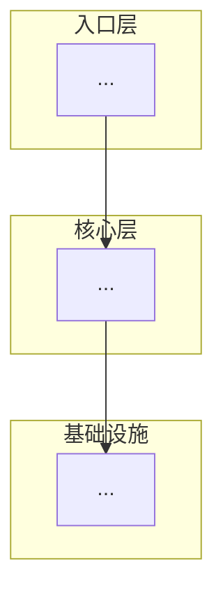
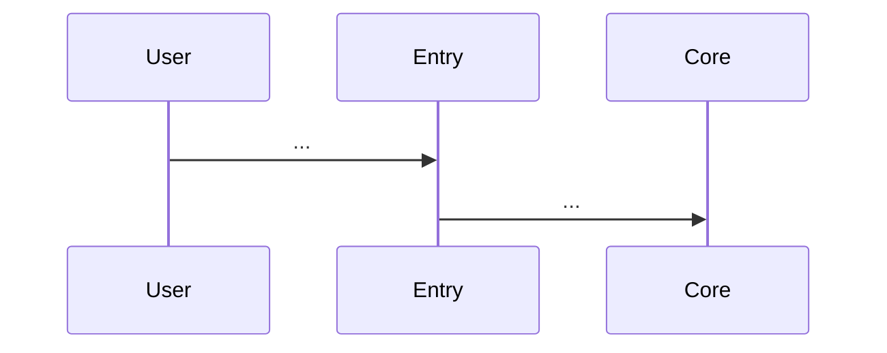

# 项目快读报告模板

复制此模板填写；删除不适用的章节，保留 `N/A` 说明原因。

```markdown
# [项目名称] 快读报告

> **模式**：Express / Standard / Deep  
> **路径**：`[绝对或相对路径]`  
> **扫描时间**：YYYY-MM-DD  
> **仓库来源**：[GitHub URL 或「本地/未知」]

---

## 0. Executive Summary（30 秒读懂）

| 项 | 内容 |
|----|------|
| **一句话** | [项目是什么] |
| **类型** | Web / CLI / Library / ML Pipeline / Full-stack / … |
| **成熟度** | 实验 / POC / 可演示 / 生产就绪 / 未知 |
| **运行状态** | 已验证 / 部分可运行 / 未验证 |
| **推荐行动** | 深入 / 观望 / 仅参考 / 不建议 |

[2–4 句补充：最大价值 + 最大风险]

---

## 1. 项目目标与边界

### 1.1 解决什么问题
- …

### 1.2 目标用户
- …

### 1.3 核心能力（功能列表）
1. …
2. …

### 1.4 明确不做的事（Out of scope）
- …

### 1.5 许可证与约束
- License: …
- 商业/二次分发注意：…

---

## 2. 技术栈

| 层级 | 技术 | 证据（文件/版本） |
|------|------|-------------------|
| 语言 | | |
| 框架 | | |
| 数据库/存储 | | |
| 消息/缓存 | | |
| 前端 | | |
| ML/AI | | |
| 基础设施 | Docker/K8s/… | |

**版本要求**：…  
**外部服务依赖**：…

---

## 3. 目录与架构

### 3.1 顶层目录职责

```
project/
├── …   # 职责
└── …
```

### 3.2 架构风格
[Monolith / Microservices / … + 一句理由]

### 3.3 分层 / 模块关系



### 3.4 入口点清单

| 入口 | 路径 | 用途 |
|------|------|------|
| | | |

---

## 4. 核心代码逻辑

### 4.1 主流程（Happy Path）

[分步骤叙述，附关键文件路径]



### 4.2 关键模块

| 模块 | 路径 | 职责 | 关键符号 |
|------|------|------|----------|
| | | | |

### 4.3 数据流
- **输入**：…
- **处理**：…
- **输出/持久化**：…

### 4.4 配置与环境
- 配置来源：…
- 必需环境变量：…
- 配置陷阱：…

---

## 5. 工程化现状

| 维度 | 状态 | 说明 |
|------|------|------|
| 文档 | ⭐… /5 | |
| 测试 | ⭐… /5 | |
| CI/CD | ⭐… /5 | |
| 类型安全 | ⭐… /5 | |
| 安全基线 | ⭐… /5 | |
| 可观测性 | ⭐… /5 | |

**CI 摘要**：…  
**测试如何跑**：…

---

## 6. 运行与复现

### 6.1 官方步骤（README）
```bash
# ...
```

### 6.2 实测步骤（若已验证）
```bash
# ...
```

### 6.3 运行结果
- 成功/失败：…
- 缺失项：…

---

## 7. 优势与劣势（SWOT 精简）

### 7.1 优势 ✅
1. …

### 7.2 劣势与风险 ⚠️
| 级别 | 项 | 说明 |
|------|-----|------|
| 🔴 | | |
| 🟡 | | |
| 🟢 | | |

### 7.3 与同类/预期差距
- …

---

## 8. 缺口清单（仓库缺什么）

- [ ] …
- [ ] …

---

## 9. 上手路径

### 15 分钟
1. …

### 1 小时
1. …

### 1 天
1. …

---

## 10. 待澄清问题（给维护者/自己）

1. …
2. …

---

## 11. 附录

### A. Phase 0 扫描摘要
[粘贴 scan_project.py 关键 JSON 字段或表格化]

### B. 关键文件阅读清单
| 优先级 | 文件 | 原因 |
|--------|------|------|
| P0 | | |
| P1 | | |

### C. 术语表（可选）
| 术语 | 含义 |
|------|------|
| | |
```
